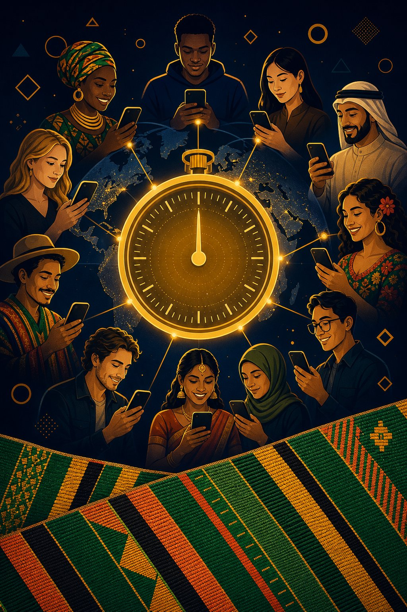

# AYO — The Everyday Games

### One round a day. Every country on Earth. Made in Lagos.

*A concept, format and business plan for a reality game that the whole world can
actually enter — with a working prototype of the daily game included in this
repository.*

---

## 1. The idea, in one breath

Every day, at midnight UTC, the entire planet receives **one task**.

It takes sixty seconds. It measures something every human being already owns —
your inner clock, your memory span, your sense of rhythm, your eye for what is out
of place. Everyone on Earth gets the same task on the same day. You score for
yourself and for your country. Nothing about it can be bought, studied for, or
translated.

At the end of the season, the best players in each nation are flown to a live,
filmed **World Final** — and the audience plays the same round at home, live, with
their scores appearing on screen.

That is the whole game. It is called **AYO** (Yoruba: *joy*, and also the name of
the ancient mancala game played across Africa, Asia and the Caribbean — a game
older than most countries and already owned by everyone).

---

## 2. The problem with every "global" game that exists

Games claim to be global all the time. Almost none of them are. Run the test:

| Format | Who actually wins | Why |
|---|---|---|
| Trivia / quiz | Educated, Western-media-saturated players | Rewards schooling and cultural exposure, not ability |
| Word games | Native English speakers | Language is a passport, not a skill |
| Esports | Whoever has the best hardware and lowest ping | Bandwidth is a paywall |
| Step counts & fitness | The wealthy, with time and safe streets | Rewards free time, not capability |
| Chess, Go, poker | A self-selecting elite who started at six | Years of coaching, not a level field |

Every one of these has the same hidden flaw: **it measures the advantages a
person was born into, and calls it talent.**

A genuine world championship needs disciplines where:
1. the raw ability is distributed across all eight billion of us, and
2. the advantage cannot be purchased, inherited, studied or translated.

Those disciplines exist. They are just not the ones anyone has commercialised.

---

## 3. The seven faculties

AYO measures seven things that belong to every human being. One discipline is
played per day, and **each week contains all seven exactly once**, so a week is a
complete decathlon of the mind and no single talent decides a season.

| # | Discipline | Faculty | What you do |
|---|---|---|---|
| 1 | **The Inner Clock** | Time sense | Feel exactly ten seconds pass. No clock, no counting. |
| 2 | **The Jar** | Estimation | A jar of grains flashes for two seconds. How many were there? |
| 3 | **The Chain** | Working memory | Repeat a growing sequence of symbols until you break. |
| 4 | **The Pulse** | Rhythm | Tap along with a drum, then keep the beat when it goes silent. |
| 5 | **The Odd One Out** | Attention | Sixty-four identical shapes. One is very slightly turned. |
| 6 | **What Comes Next** | Pattern | Work out the hidden rule and name the future. |
| 7 | **Think Like Earth** | Social intuition | Answer for yourself, then guess how humanity answered. |

Each one is chosen because it is **measurable everywhere and purchasable
nowhere**. They are the subject of a century of psychophysics research, which
means they can be scored on real, published human distributions rather than
invented ones.

### Why these seven work globally

- **No literacy required.** Five of the seven use only shapes, colour and sound.
  You do not need to read to beat a professor.
- **No equipment.** Every task runs in a browser on any phone made in the last
  decade. There is nothing to upgrade.
- **No translation.** Shapes do not have a language. A drumbeat is not English.
- **No schooling.** None of it is taught in any school on Earth.
- **Sixty seconds, one hand, any light.** Fits into a bus queue, a farm break, a
  night shift.
- **Roughly 200 KB and one small request.** The whole game runs on the device, so
  it works on a 2G connection. Only the final score is sent.

### The discipline that could only exist now: *Think Like Earth*

Players answer a human question — *"Which is harder: starting something new, or
finishing something old?"* — and then score on **how closely they matched
humanity's dominant answer.**

The answer key does not exist when the round begins. Humanity writes it, hour by
hour, as the day rolls west across the planet — and the scoring curve is fitted
onto whatever spread the world actually produces, so a question that unites
humanity and one that splits it are scored on their own terms. It is a game about
understanding people, and the target moves because of who is playing. Nothing
like it has been possible before, because nothing like this has ever been played
by everyone at once.

---

## 4. The format

### The daily round

- **One discipline a day**, identical for every human, live 00:00–23:59 UTC.
  The world window opens in Auckland and closes in Honolulu.
- **Sixty seconds.** Playable on a phone, one-handed.
- **Unlimited practice, exactly one scored attempt.** Practice can never overwrite
  your real score, and the rule is enforced on the server, not on the honour
  system.
- **Score 0–1000**, calibrated so the **median human scores about 500**. A
  number that means something in every country: 500 is an ordinary human being,
  900 is extraordinary.

### The three tables

| Table | Metric | Why it exists |
|---|---|---|
| **Your score** | 0–1000, one per day | The honest mirror |
| **Nations by median** | The exact middle player in each country | Population cannot inflate it; one genius cannot carry it. Only **depth** moves it. |
| **Per-human index** | Best 25 players ÷ population^¼ (1000 = the average nation) | Lets a nation of forty million beat a nation of a billion. Population floored at one million so nobody wins for being tiny. |

The median being the primary national metric is the single most important design
decision in the product. It means the way a country climbs is **recruiting more
ordinary players** — not finding one champion. That is what makes AYO a national
project rather than a talent show, and it is what gives it a distribution engine
no marketing budget can buy.

### The season

- **Weekly tower**: seven rounds, one per faculty.
- **Season**: twelve weeks. Countries climb the world table.
- **National final**: each country's top players play live, in public.
- **World Final**: 32 nations × 1 champion, filmed over ten days. One discipline
  per episode. Broadcast weekly. The live audience plays the same round at the
  same moment and their scores appear on screen.

---

## 5. Nigeria to the world

This is not a decal on a Western product. It is a product built in Lagos, for a
market that behaves like the future and was designed for by nobody.

### Why Nigeria first — and why that is a strategy, not a limitation

Nigeria is not a compromise launch market. It is the correct one, for four
reasons:

1. **Mobile-first isn't an edge case here — it's the default.** Building for a
   ₦40,000 Android on an intermittent network produces a product that works
   everywhere. Building for a flagship on wifi produces a product that works
   almost nowhere. Designing for Lagos first is how you accidentally build the
   only genuinely global game.
2. **The price must be zero, and here it already is.** No one is buying a $60
   game, a console or a subscription. The primary market forces the free-forever
   architecture that the whole world then benefits from.
3. **The audience is young and enormous.** 232 million people, median age
   around eighteen. A daily habit takes root fastest in the youngest large
   population on Earth.
4. **Nothing here is imported culture.** Ayo is the name of a game Nigerians have
   played for centuries. The design language is aso-oke cloth, Lagos green,
   harvest gold. The screen says *"think like Earth"*, but the accent is ours.

The pitch, from Lagos, is simple:

> **Nigeria to the world.** We are not asking for a seat at someone else's table.
> We built the table.

### The rollout

| Phase | Timeline | Move |
|---|---|---|
| **0. Lagos proof** | 0–3 months | Campuses, NYSC camps, football supporters' clubs, faith youth groups, 20 radio stations, WhatsApp group seeding. Target: 250,000 Nigerian players. |
| **1. West Africa + diaspora** | 3–9 months | Ghana, Kenya, South Africa, Senegal. The diaspora is the cheat code: ~17 million Nigerians abroad, the most motivated distribution network on Earth, competing for the home country. |
| **2. Global waves** | 9–18 months | Launch by time zone in mobile-first, young-population markets — India, Indonesia, Brazil, Philippines, Egypt, Vietnam, Pakistan — then Europe and North America. |
| **3. The show** | 18–30 months | National finals, then the first filmed World Final. Season 2 with title sponsors and broadcaster deals. |
| **4. The institution** | Year 3+ | National federations, a permanent world ranking, and the longitudinal dataset as a public research asset. |

**The diaspora insight is worth stating plainly.** For a Nigerian abroad, this is
the first competition where you can represent your country by playing with your
thumb on a bus. That converts identity into distribution at zero cost. Every
launch phase reuses it: Ghanaians in London, Indians in Dubai, Filipinos in
Riyadh. Migration is the global growth channel, and nobody is using it.

---

## 6. From phone game to reality television

The daily game is the qualifying stage. **The show is the product the world
watches.**

### Why the seven disciplines are unusually good television

- **Legible in three seconds.** A jar of grains. A drum that goes silent. A grid
  of sixty-four shapes with one wrong. No rules explanation, no jargon — a viewer
  in any country understands the stakes instantly and can judge the performance
  themselves.
- **Inherently tense.** Twenty seconds of a stranger keeping a beat after the
  drum stops is genuinely unbearable to watch, because your own body plays along.
- **National stakes with no national advantage.** Unlike sport, no country has
  better equipment, better genetics or a deeper bench. Every nation arrives with
  the same raw material: human minds. That makes it the only world championship
  that is actually a fair fight.
- **The audience is a competitor.** This is the crucial difference from every
  other reality format. While a champion plays in the studio, forty million
  people at home are playing the identical round on their phones. Scores appear
  live on screen, region against region, while the broadcast runs.

### The programme

| Format | Length | Content |
|---|---|---|
| **The Daily** | 60 sec | The round itself. Vertical, shareable, built for TikTok and Reels. |
| **National Finals** | 90 min × N | One per country. Filmed live. A nation picks its champion. |
| **World Final** | 10 × 60 min | 32 nations, one discipline per episode, live audience playing along. |
| **The Long Game** | Documentary | A year inside the training lives of six players from six countries. |

The economics are favourable because the expensive asset is the show, not the
game. The daily round runs on a static client and a tiny API — it costs almost
nothing per player, which means the audience that the show monetises can be built
before the show exists.

---

## 7. Business model

**The rule that governs everything: nothing that affects a score can ever be
sold.** Not to a player, not to a nation, not to a sponsor. The moment a score can
be bought, the championship is dead and so is the audience's belief in it.

| Stream | Mechanism | Score-neutral? |
|---|---|---|
| **Presented rounds** | A brand presents a discipline — "The Pulse, presented by…". Visibility only. | Yes |
| **Broadcast & licensing** | World Final rights sold per territory. | Yes |
| **Cosmetics season pass** | Flag frames, avatars, streak badges. Never scoring. | Yes |
| **National partnerships** | Federations, ministries, universities, telcos sponsoring their country's team. | Yes |
| **Insights & research** | Aggregate, anonymised, opt-in cross-cultural norms data — genuinely novel at this scale. | Yes |
| **Not** | Pay-to-win, loot boxes, ad-gated scores, selling personal data. | Refused |

### The asset nobody else has

A longitudinal, cross-cultural dataset of human timing, memory, attention and
social-norm behaviour across 190 nations does not currently exist. Neuroscience,
education research, and cross-cultural psychology have all wanted it for decades
and none of them have the reach. A daily game does.

It is monetisable **and** it must be governed honestly: aggregate only, opt-in,
never individually identifying, published norms by country, and a public
commitment that a nation's data is never used to characterise its people
unfairly. Handled badly, this is a reputational time bomb. Handled well, it is
both a revenue line and the most credible scientific contribution the product
makes.

---

## 8. Fairness: the full design

Fairness is not a feature of AYO. It is the product. Without belief that the
contest is real, there is no audience and no sponsor.

### Published as the Fairness Charter, in-app

1. **One world, one round.** Identical discipline, same UTC day, no regional
   variants, no exceptions.
2. **Nobody can buy a score.** Every discipline measures something money cannot
   fix. There is no equipment to upgrade.
3. **Free, and light.** ~200 KB, works on 2G, queues your score when the network
   drops and sends it when you return.
4. **No knowledge required.** No letters, numbers, flags, brands or trivia.
   Nothing here is taught in any school on Earth, so schooling cannot decide a
   round.
5. **Population cannot win.** Nations are ranked by median and by a per-human
   index.
6. **You cannot copy a country.** Half the disciplines are physically
   unshareable; the other half are drawn per player from a private seed.
7. **The answer key is humanity.** In *Think Like Earth*, the answer key is
   whatever the world actually chose. No expert, no broadcaster and no sponsor
   decides it — and the live tally stays sealed until you have answered, so no
   one can play late in the day and copy the finished key.
8. **Honest about simulation.** Where the game has not launched, simulated
   players keep the board alive — labelled `demo` everywhere, never counted as
   humans.
9. **Colour is never the answer.** Every shape carries a fixed colour, and no
   discipline is decided by colour. The attention and pattern rounds are
   provably solvable with colour vision removed — enforced by an automated
   test, not by intention. An earlier version of this game failed that test and
   was rebuilt.
10. **Honest about ability, too.** Six of the seven disciplines need only sight
    or touch; the seventh can be listened to. Each one declares what it demands
    of a player's body, in the app, so the claim can be checked.

### The client does not choose the task, or the day

Three further holes were found by auditing what the server believes from a
client. All three are closed.

**The named discipline was not checked against the round.** On a
social-intuition day a player could post a perfect timing result — scored
honestly by the server, from a real curve — and take rank 1 on a task the world
was never given. Every discipline has its own curve, so without that check the
ceiling was one crafted request away. The endpoint now refuses any result whose
discipline is not the round's.

**The client chose the date.** A result could be submitted for any day at all,
including days that had not happened. Probe a future round with throwaway
pseudonyms, keep the best, submit it under your real name, and a perfect score
is seeded weeks in advance. The server decides the day now, with one honest
exception: UTC midnight is arbitrary for most of the world, so a player who
starts at 23:58 and finishes at 00:01 can still submit for the round they
actually played, for two hours after midnight and no longer.

**The data store was being served over HTTP.** A leftover mount mapped
`/shared/<x>` to the repository root, so `/shared/data/store.json` returned —
unauthenticated — every player's pseudonym, country and raw answer, and the
per-round wisdom tally: the answer key, for a round still open. Nothing
referenced the mount; it has been removed rather than restricted, and the
containment check behind it was itself wrong (it compared paths with
`startsWith`, under which `/srv/app-data` counts as being inside `/srv/app`).

A `?date=` query is now bounded to a week either side of today. Reading the
rotation ahead is harmless — it is public and a week long — but an unbounded
date let a caller mint and persist round state for any day in the calendar, one
request at a time.

### The client does not choose who it is

The third and last version of the same bug. The server had already stopped
letting a client choose the discipline and choose the day. It was still letting
it choose **who it was** — and that one was doing more damage than either:

- **Unlimited scored attempts.** An attempt was keyed to `pseudo::country`, a
  string the client picked. Five requests with five names bought five separate
  scored attempts in one round, and all five sat on the world board at once.
- **One person could move a country.** Nations are ranked by *median*, which was
  the whole point of ranking by median — population cannot inflate it. But five
  entries from one person can, and a loop makes it hundreds.
- **The sealed answer key was not sealed.** It opened for any *name* that had
  already played. Names are published on the leaderboard, so a client that had
  never answered could borrow a name off the board, read the live distribution,
  and submit the leading option for a near-certain maximum. The seal was
  guarding the wrong thing.

All three close the same way: an account, meaning an identifier the client
cannot invent. It is deliberately tiny, because everything larger would be a
tax on the people this game most wants to reach:

| | |
|---|---|
| `id` | 12 random hex characters, public — it is on the board |
| `token` | 24 random bytes, secret, held by the device |
| `code` | a human-typable recovery key, read off one phone and typed into another |

No email, no password, no third party, nothing personal, and only hashes are
stored. The account is minted on a player's **first score**, because a signup
before the first round is friction for nothing.

Two decisions carry the weight, and both are written down because either one
inverted would reopen the hole:

**A token we do not recognise is a refusal, never a new account.** If garbage
bought a fresh account, a cheater would send nonsense to buy another attempt.
Only the complete *absence* of a token means a new player.

**Attempts belong to the account, not to the name.** This is what makes "one
round, one score" a rule rather than a suggestion.

The honest limitation: creating a new account is still free, so a determined
cheat can still start over. Accounts remove *cheap* replay — the kind that takes
one request — not determined fraud. Making that hard needs device attestation or
identity documents, and both would cost more privacy than this game is willing
to spend. It is also why a place in the televised finale is confirmed in person,
and why the daily board is a leaderboard rather than a qualification list.

### Standalone first: AYO keeps its own front door

**A decision, recorded so it is not relitigated: AYO is a standalone product.**
It keeps its own domain, its own accounts, its own store, and its own identity.
Other apps reach it through the documented JSON API and through deep links —
never through a shared identity or a passport handed to a host.

Three reasons, in order of how much they cost to get wrong:

1. **Identity is the product.** "One round, one score" is what makes this a
   competition rather than a pastime, and it rests entirely on the account. The
   moment a host owns the identity, the host owns the fairness guarantee. This
   was not theoretical: an embedded AYO produced four accepted submissions in a
   single round, silently, because the hosting context could not keep a token.
2. **A daily game needs its own door.** The streak, the season tower and the
   recovery key accrue to whoever's surface the player returns to. If players
   only ever meet the round inside another company's app, AYO is a feature of
   that app — and features do not get their own brand, audience, or agency.
3. **Partner from strength, not as a supplier.** A standalone game with its own
   players can partner with anybody. A feature inside one app has one customer,
   and no pricing power inside it.

This does **not** mean isolation, and it does not mean "no partnerships." It
means the partnership shape is chosen to preserve the front door: **the deep
link.** A host offers "play today's round", the player arrives at AYO's own
address, and AYO keeps the account. The host gets the daily habit; AYO keeps its
identity. Distribution without dependency.

**The honest cost of this choice:** a standalone game has to find its own
players, and nobody finds you by accident. Distribution is genuinely the hardest
part of this plan — which is exactly why borrowing an audience is worth doing,
and exactly why it must happen without handing over the thing the game is built
on.

### Distribution: borrowing somebody else's audience

The hardest problem in this document is not the game. It is that a game nobody
has heard of has no players, and a daily competition needs a crowd on day one to
mean anything. **The strongest answer is not an advertising budget — it is
somebody else's audience.**

Nigeria now has a proof that this works. *Lagos Life*, a browser life-sim built
by one developer and launched on 1 October 2026, reached **two million players
in a week** with 145,000 playing at once — with no app store, no install, and no
marketing spend. It spread by link, on mobile data, through X and TikTok. That is
exactly the distribution shape AYO needs, and it validates the whole premise of
this document: build for the browser and for cheap phones, and Nigerians will
come.

It also points at the single most valuable partnership available. **A life sim
and a daily challenge want opposite things and give each other what they lack.**
A life sim is a long, open session — a player can spend an hour or forget it for
a month. AYO is two minutes, once a day, and then it is over. The life sim has
the audience and the session; AYO has the reason to come back *tomorrow*. That
is not a competitor; it is the retention mechanic the other game has not built.

Two ways to put AYO inside another app, and the honest difference between them:

| | |
|---|---|
| **Deep link** — a "Today's round" button that opens AYO in its own tab | Full identity, streak and season tower. One line of integration, no shared state, no data exchange. **This is the one to propose first.** |
| **Native module** — the host renders the round and calls the AYO API itself | The round appears inside the host's interface, which is better for engagement; but the host then holds the identity, and the two platforms have to agree on who a player is. Real work, real gain, worth doing second. |
| **Iframe** | Technically supported, but third-party storage is blocked or partitioned, so a player ends up with a separate tower inside the host and the same round can be replayed by reloading. AYO now refuses to score in that context rather than pretend. |

There is a limit worth stating openly: this is a partnership, not a build. It
needs the other studio to want it, and the first approach should therefore be a
demonstration and a proposal, not a specification. What AYO can bring to that
conversation is a working prototype, a fairness charter that survives inspection,
and instrumentation that can prove — with the host's own numbers — whether the
daily round lifts the days people come back.

### Names, and the human in the loop

Names appear on a world board, beside a national flag. Before this, the only
rules were "trim it, at most 18 characters" — so markup, slurs and placeholders
all landed on the same board as everybody else.

Names are now checked where they are typed *and* on the server: a charset rule
(which rejects markup structurally rather than by an ever-growing list), at
least three distinct letters, a short denylist, and reserved words that would
let someone impersonate the game itself. One name maps to one account per
round, so a name on the board means one person.

Automated filtering of language is a losing game — every list long enough to
catch everything starts rejecting real surnames — so the filter is best-effort
by design, and that is stated rather than implied. What covers the rest is a
human with a tool: a strike removes an entry **and the aggregates it fed**, so
a removed score cannot leave a nation's median inflated. Three strikes suspend
an account. Every action is recorded with its reason, because a moderation
power with no record is indistinguishable from tampering.

### How cheating is actually prevented

| Attack | Defence |
|---|---|
| Client edits its own score | Scores are **never** accepted from the browser. The server recomputes from the raw measurement and ignores anything else in the payload. |
| Replaying today's round for a better score | One scored attempt per day, enforced server-side. Practice is a separate, unscored path. |
| Reading the live answer key before answering | The tally in *Think Like Earth* is sealed until the player has submitted. Otherwise a player at 23:00 UTC could read a near-final key and copy it for a near-certain maximum. |
| Copying a friend's answer | Type A disciplines are unshareable; Type B are regenerated per player from a private seed. |
| Bot flooding | Input range validation, per-IP rate limiting, and a score distribution that makes a swarm visible. |
| Submitting for a closed round | Round IDs are validated against the server clock. |
| Inflating a nation with fake players | The median is robust to small numbers of outliers, and the per-human index requires 25 real plays. |

### The calibration promise

Every curve is shipped in public with its source assumptions. At the end of each
season, curves are re-fitted against live global data. **If a discipline turns out
to favour one region for cultural reasons, it is rewritten or retired — in
public, with the numbers shown.**

This is what separates a world championship from an export. We change the game
for the world, not the world for the game. It is also the sharpest possible
answer to the obvious scepticism: *"who decided what 500 means?"* The answer is
published, sourced, and revisable by evidence.

---

## 9. Accessibility, stated plainly

A game whose entire claim is fairness has to be able to show its work. These are
the real positions, including the ones we got wrong.

### What was broken

The first version of this game failed its own promise in three places:

1. **The pattern round's opening puzzle varied only the colour of identical
   shapes.** All four answer options were the same shape in different colours.
   A player with red-green colour vision deficiency — roughly 8% of men, about
   300 million people — could not solve it at all, and the shipped palette made
   it worse: the gold, green and coral sat directly in the deuteranopia
   confusion zone, with a measured difference of **9.0**, where ~2.3 is a
   just-noticeable difference.
2. **The attention round tinted its answer gold** while the other sixty-three
   shapes were pale blue. That handed the answer to anyone who could see colour
   — so it was not an attention test at all — while making it genuinely harder
   for everyone else.
3. **Speech was the primary channel for the rhythm round**, with only a small
   dot as a visual substitute — not an equal one.

### What is now true

- **Colour is never the dimension being tested, in any discipline.** Every shape
  carries a fixed colour, so colour can only reinforce shape identity. No
  discipline is decided by colour.
- **The pattern round is provably solvable with colour removed.** An automated
  test generates 720 puzzles across all six pattern families, deletes every
  colour from the options, and asserts the correct answer is still uniquely
  identifiable. If a future change reintroduced a colour-dependent puzzle, the
  build would fail.
- **The palette was re-fitted rather than guessed.** The new five-colour set
  scores a minimum difference of **28.8** across simulated protanopia,
  deuteranopia and tritanopia — up from 9.0. A sixth colour was tested and
  rejected: every candidate either collapsed toward blue under protanopia or
  fell to ~1.4:1 contrast against the background and became invisible.
- **The attention round uses one colour for all sixty-four shapes.** Rotation is
  the only signal, so it measures attention for everyone equally.
- **The rhythm round carries its beat three ways** — sound, a full-width visual
  pulse, and vibration — so it does not depend on hearing. All seven disciplines
  are tested to build and run with audio disabled entirely.
- **No discipline requires reading to compete.** Six of the seven need only sight
  or touch. The social-intuition round is the one whose content is language, and
  its question and all four options can be read aloud on any device that offers
  speech. Each discipline now declares what it demands of a player's body, in the
  Fair Play screen, so the claim is checkable rather than asserted.

### What is still not fixed

- **Motor impairments.** Rhythm and timing rounds require repeated precise taps
  within a limited window. Larger targets would help; a genuinely accessible
  alternative has not been designed.
- **Instructions and interface are still English text.** Read-aloud removes the
  barrier for the one round whose *content* is language, but a non-reader still
  needs help to learn the rules the first time. Translated and spoken interfaces
  are in the 90-day plan.
- **No screen-reader support** for the visual disciplines. Several of them
  measure visual attention by definition, which is a genuine tension rather than
  an oversight — but the tension should be documented, not ignored.

We would rather publish this list than imply the game is accessible because it
is well-intentioned. The pattern-round defect in particular is exactly the kind
of failure a fairness-first project has to be able to catch, admit and test
against.

## 10. Honest risks, and the answers

| Risk | Honest assessment | Mitigation |
|---|---|---|
| **Some disciplines may carry cultural bias** (e.g. rhythm familiarity, or comfort with timed tasks) | Real, and the most serious technical risk. | Publish norms by country from day one; monitor residuals; retire biased disciplines publicly. The seven-faculty rotation means no single bias decides a season. |
| **Cheating at scale** (emulators, farms, collusion) | Certain to be attempted. | Server-side scoring already removes the largest hole. Add device attestation, anomaly detection and prize-tier manual review as stakes rise. |
| **Timezone fairness** | A player in New Zealand plays first and could leak the task. | Type A tasks are unshareable and Type B tasks are per-player — a leak is nearly worthless. This is a design property, not a policy. |
| **Determined multi-account fraud** | Creating a new account is free, so someone determined can start over after being suspended. Accounts remove cheap replay, not fraud. | Accepted and documented. Hardening this needs device attestation or identity documents, and both cost more privacy than this game is willing to spend. Finale places are confirmed in person for exactly this reason. |
| **Language of the questions** | *Think Like Earth* is written in English. A player who does not read English cannot play that round, and read-aloud only helps if their device speaks it. | A real gap, and a large one — it is the round that carries the most cultural interest. Translation into the launch market's languages is the honest fix; a language-free substitute would be inventing a new psychophysics test and risking cultural bias, which is worse. |
| **Accessibility** | This was the project's worst failure: the first version of the pattern round varied only the *colour* of identical shapes, and the attention round tinted its answer gold. Roughly 8% of men worldwide could not solve the first, and the second was not an attention test for anyone who could see colour. | Fixed, and enforced by automated test rather than intention — see the accessibility section below. Motor impairments remain only partly addressed. |
| **Cold start in a new country** | An empty national table kills retention. | The labelled demo world plus diaspora seeding. Honest labelling protects trust while it fills. |
| **Fatigue with a daily format** | Real; day-40 drop-off is the norm. | Seven faculties in rotation, weekly towers, national pride, and practice mode for people who want more. |
| **Being dismissed as a "Nigerian app"** | The bias exists and will be voiced. | Answer with the product: it is measurably fairer than the alternatives, and the disciplines are universal by construction. K-pop, Nollywood and Afrobeats ended the same argument in their industries. |

---

## 11. What we measure

A daily game is one habit long. If people do not come back tomorrow, nothing
else on this page matters — not the finale, not the sponsors, not the federation
of national leagues. So the product measures one thing and measures it properly.

### The question, and the numbers that answer it

**Did the people who opened the game today come back tomorrow?**

Four numbers answer that, and they are the only four collected per day:

| | |
|---|---|
| **Opens** | how many times the game was opened, split into first-ever devices and devices seen before |
| **Starts** | how many of those opens began a round |
| **Finishes** | how many were seen through to a submitted score |
| **Abandons** | started, then left without a score |

Every open that was not a first-ever device is a return. That is the whole
mechanism: a daily game's health is the ratio between people arriving and people
coming back, and it is visible within two days of launch rather than at the end
of a quarter.

The cohort table then answers the durable version of the question — of the
people who first arrived on a given day, what share were still playing on day 1,
day 7, day 30? Those are the three horizons because those are the three the
business model actually depends on: day 1 is whether the game is any good, day 7
is whether it is a habit, and day 30 is whether it is a habit that survives a
bad week.

**One honesty rule is built into the arithmetic: a horizon that has not
elapsed is reported as "not yet measurable", never as zero.** A cohort that
arrived yesterday cannot have a day-30 rate. Rendering that as 0% would be a
lie dressed as a number, and it is the most common way a dashboard misleads the
people reading it.

### What is deliberately not collected

The instrument is striking for what is absent, and that absence is the design:

- **No name, no country, no score, no email.** An event carries four fields: a
  name, a time, the round, and a random id made on the device.
- **No third party.** Not an analytics vendor, not an ad network, not even a
  CDN font. The client posts to AYO's own server and nowhere else. This is what
  makes the game weigh ~200 KB, and it is also why nobody else can build a
  profile of an AYO player.
- **No cookies, no fingerprinting, no cross-site anything.** The id cannot
  follow anyone to another site because it is never shared with one.
- **No free-form payload.** The server accepts an allowlisted event name, caps
  a batch at 64, and stamps the date itself. A client cannot write arbitrary
  content into the store, and cannot write activity into any day but today.
- **The operator's own report contains no ids.** The `/api/retention` payload is
  aggregates only, so even someone reading it learns nothing about a person.

### Refusable, in one tap

Do Not Track is honoured automatically. Beyond that, the player can switch
counting off from inside the Fair Play screen — the same screen that makes the
fairness claims — and switching off **deletes anything already queued** rather
than merely stopping the next batch. Turning it back on is one more tap.

This is a small thing and it is the point: a game whose entire proposition is
"I will not tilt the contest against you" cannot quietly profile the people it
is measuring. The instrument is described in the app, in the same place and the
same voice as the charter, and it is switchable.

### Growth is bounded by design

Nothing here can grow without limit. A device's history is capped at 120 days
(the longest horizon is 30), tracked devices are capped at 20,000, day
aggregates are capped at 400 days, and the local send queue is capped at 120
events. The instrument must never become the thing that fills a disk.

### Why this had to come before anything else

Retention instrumentation is usually added after launch, when someone asks why
the numbers are falling — and by then the first month of the only period that
cannot be re-run is already gone. Because this game's launch market is
deliberately one country at a time, the first cohort is also the smallest and
the least forgiving: Nigeria's numbers will be read closely, and they need to be
trustworthy on day one rather than reconstructed in hindsight.

## 12. The season

Everything above is one round. A round is not a competition — it is a daily
ritual. What turns it into a competition, and eventually into a finale, is the
season, and the season needs a rule that decides who carries a country.

### Twelve weeks, and why that number

A season is **twelve weeks: eighty-four rounds.** The reason is structural
rather than decorative. Every week contains all seven faculties exactly once, so
a week compares like with like, and twelve of them is the shortest span that
still feels like a campaign rather than a fortnight. It also lands four seasons
a year, which is the right cadence for a broadcast schedule: one filmed finale
per quarter, with the country-by-country roll-out happening between them.

### The qualification rule

**Your best 40 rounds of the 84, and you must play at least 24.**

That sentence is the whole competitive design, and every number in it was
chosen against one constraint: **connectivity.**

- **Why not all 84?** Because most of the world does not have a reliable daily
  connection, and the launch market certainly does not. Requiring perfect
  attendance does not measure skill, it measures income — and it would exclude
  precisely the players this game claims to exist for.
- **Why not sum everything played?** Because that rewards grinding rather than
  excellence, and makes one absent day a permanent penalty on an otherwise
  strong season.
- **Why not average everything played?** Because four lucky rounds then beat
  eighty good ones. That is the "play once, score perfect" failure this project
  already had to fix at the daily level, and it would be worse here: it would
  hand the finale to whoever got lucky once and stopped.
- **Why 40, and why 24?** 40 is just under half the season, so a player is
  always choosing from a broad sample rather than a lucky few; the 41st-best
  round is worth exactly nothing, which is what bounds the advantage of playing
  more. 24 is under three rounds a week — clearable on a patchy connection,
  and still a real commitment.

There is an honest tension and it is not hidden: **a player who plays more
rounds has more chances to fill their best 40.** A reliable connection is still
an advantage in contention. It is bounded, and the floor is low enough that it
does not decide *qualification* — but it does shade *ranking*, and it will keep
doing so until mobile data is cheap in Lagos. Naming that is better than
pretending the game is level when the infrastructure is not.

### How nations qualify

Two different things are being measured, and keeping them separate is the point:

| | |
|---|---|
| **Who carries the flag** | the individual season winner |
| **Which countries have depth** | nations ranked by the **median** of their qualifying players |

Nations rank by median for exactly the reason the daily board does — population
must not buy a place, and one prodigy must not make a country look strong. A
country is only ranked once it has at least five qualifying players, and until
then it is shown as unranked with the number it still needs. It is never given a
rank it has not earned, and this is stated on the screen where the ranking lives.

**The simulated demo world never competes.** It exists to keep the daily board
from being a ghost town in countries where the game has not launched, and it is
labelled everywhere it appears. Qualifying for a televised final by simulation
would be absurd, so it is excluded structurally — not filtered at the last step,
but skipped at the first.

### Mid-season honesty

Nobody is declared qualified in week one. The status a player sees is one of:

- **on track** — above the floor, season still running
- **qualified** — above the floor, season ended
- **at risk** — below the floor, but enough rounds remain to reach it
- **out** — below the floor, and not enough rounds remain

`out` is the one that matters. A player who cannot qualify should be told, with
the arithmetic — "you have 10 rounds, 23 is the floor, 4 rounds remain" — rather
than left to discover it. A competition that quietly stops counting you is worse
than one that says so.

### What this makes possible

With a season in place, four things that were previously promises become
schedules:

1. **National finals.** A country with a ranked season has a defined squad, so
   a national final has actual qualifiers rather than a casting call.
2. **The filmed finale.** "The top 40 by season score" is a rule a broadcaster
   can put on a poster and a viewer can verify.
3. **Curve recalibration.** The concept's scoring curves are literature-based
   priors; the end of a season is when they can be refitted against what
   humanity actually did — which is why the engine calls them V1.
4. **The weekly cadence.** Seven rounds is a week and a week is a complete set
   of faculties, so "this week's tower" is a small, frequent, verifiable
   celebration between the big seasonal ones.

## 13. What is already built

This repository contains a **working prototype of the entire daily game**, not a
mockup.

**Working today**

- All seven disciplines, fully playable, generated per player and scored
  server-side
- The daily rotation engine — one discipline per day, all seven every week
- Scoring curves calibrated so a median human scores 500, with a perfect
  score reaching 1000
- Three leaderboards: world, national and per-human
- A national page showing a country's record, faculty strengths and live wall
- The Fairness Charter as a shipped, in-app screen
- One-scored-attempt-per-day enforced on the server
- Offline play: the full game shell is cached, submissions queue and resync
- Installable as a phone app (PWA), self-hosted fonts, no third-party trackers
- A 77-check end-to-end test suite covering the API, every screen, every
  discipline, all seven scoring curves, every attempt to cheat the endpoint, and
  a fairness suite that deletes colour from 720 generated puzzles to prove the
  pattern round is solvable without colour vision
- 196 nations with populations, and a labelled demo world so no board is ever
  empty

**Not yet built**

- Accounts and cross-device identity (the prototype is deliberately device-local)
- Season rollups and historical world rankings
- Federation, moderation and prize-audit tooling
- The filmed finale — this is a production, not a feature
- Native apps (the browser version is the point: no install, no app store, no
  gatekeeper)

**Technology position:** zero runtime dependencies, no framework, no build step,
one Node process and one JSON file. There is exactly one implementation of the
rules — `engine.js` is imported by both the browser and the server, so they cannot
disagree. The whole game is ~200 KB and runs offline. Moving to a real datastore
is a contained change behind a single function.

---

## 14. The next ninety days

**Where the plan stands.** The engineering block is finished; what remains is
reaching people. Accounts shipped **without** phone numbers — an identifier and
a recovery key turned out to be sufficient, and asking for a phone number to
play a game buys nothing the game needs.

| Weeks | Deliverable | State |
|---|---|---|
| 1–2 | Accounts, season rollups, moderation tooling | **done** — see "The client does not choose who it is" and "The season" |
| 1–4 | Accessibility: colour independence, a silent rhythm mode, read-aloud, per-discipline needs | **done** — see "Accessibility, stated plainly". Remaining: larger touch targets, keyboard-only paths |
| 1–4 | Retention instrumentation | **done** — see "What we measure". It now needs a real cohort rather than a simulated one |
| 1–4 | The season layer: twelve weeks, best 40 of 84, floor of 24, nations by median | **done** — Season 1 runs 2026-10-11 → 2027-01-02 |
| 5–6 | Hausa, Yoruba, Igbo and Nigerian Pidgin interfaces; then French, Arabic, Portuguese, Hindi, Bahasa | **next** |
| 7–8 | Lagos pilot with three universities and two radio groups | needs a host country launch decision |
| 9–10 | Curve re-fit from real pilot data; publish the first national norms | needs the pilot |
| 11–12 | Diaspora campaign and the first national final, filmed | needs a broadcaster |

**What success looks like at 90 days:** 250,000 Nigerian players, a seven-day
retention above 40%, published norms for seven disciplines, and a national final
with a broadcaster attached.

---

## 15. Why now

Three things became true at roughly the same moment:

1. **Smartphones reached the bottom of the pyramid** — the median new phone owner
   on Earth is young, African or Asian, and mobile-only.
2. **The browser became a real platform** — WebGL, WebAudio and service workers
   mean a game can be full-fidelity, offline-capable, and install-free. No app
   store, no gatekeeper, no 30% tax on a free game.
3. **Global audiences are visibly hungry for competition that isn't inherited
   advantage.** The appetite for a genuinely fair global contest exists. Nothing
   has filled it.

AYO is one round a day, sixty seconds long, for everyone on Earth, made in Lagos.

**Nigeria to the world.**

---

*Concept document and working prototype, October 2026.*
*Play it: `node server.mjs` → <http://localhost:3000>*
